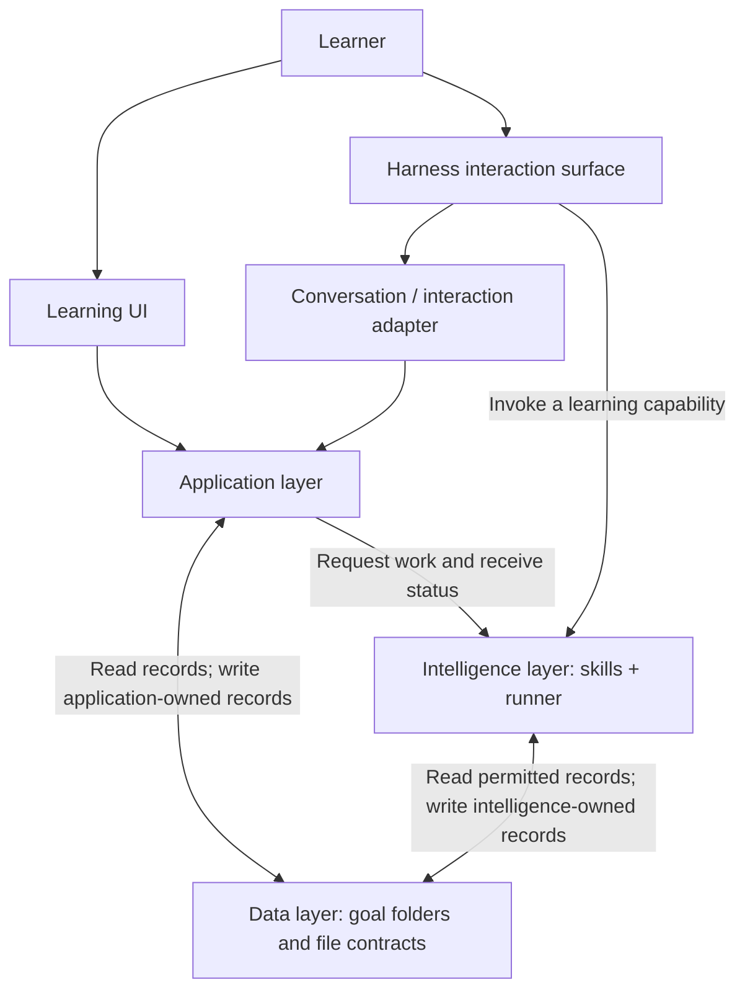

# Application, Data, and Intelligence

Status: architecture proposal. The functions, paths, and call stacks below illustrate responsibilities; they are not implemented APIs. Detailed schemas and individual component designs remain open.

## Main decision

Separate the system into three layers:

- **Application:** interaction, capture, presentation, continuity, and execution coordination.
- **Data:** durable learning records, file contracts, ownership rules, and revision history.
- **Intelligence:** goal interpretation, diagnosis, assessment, graph maintenance, planning, retention decisions, and experience creation.

Application and intelligence both access data directly within their permissions. Intelligence can read the learner's history and write its own analysis and generated experiences. Its data access does not require routing each operation through application business logic.

The learning UI and a harness conversation are two interaction surfaces. A harness can also execute intelligence work; its interface role and execution role are distinct.

## Layer relationships



The application presents selected intelligence outputs. A harness adapter records learner-visible messages and explicit learner choices through application-owned operations. Native harness logs are execution records, not automatically the product conversation.

Data is the shared interface. Job requests and completion signals coordinate when work happens; files preserve what happened and the resulting learning state.

## Application layer

| Component | Responsibility |
| --- | --- |
| Workspace manager | Create, open, list, rename, and archive goal folders; manage learner settings. |
| Conversation controller | Record learner messages, display responses, and preserve the actual learner-visible dialogue. |
| Experience runtime | Load a selected module version, run its UI, and provide its connection to the host application. |
| Capture library and receiver | Capture meaningful actions and persist observations with the appropriate session and task context. |
| Session manager | Maintain current activity, drafts, saved interaction state, and return points after detours. |
| Intelligence job coordinator | Dispatch work, track status, and handle interrupted or failed execution. |
| Time and notification service | Detect scheduled review times and surface notifications according to learner preferences. |
| Learning UI | Present conversations, activities, progress, and learner controls. |
| Harness-facing interaction tools | Expose application operations for recording messages, learner choices, and submissions through another interface. |

The application also uses the data layer's read/write utilities. Those utilities enforce record contracts without deciding teaching policy.

The application captures an answer; intelligence interprets it. The application detects a due review; intelligence chooses the review experience. The application activates a module version; intelligence selects or generates the experience.

## Data layer

Data lives in goal folders, with shared learner information and contracts at the workspace level. See [the file data model](file-data-model.md) for record responsibilities.

The data layer consists of files plus reusable operations for reading, validating, publishing revisions, and preserving history. These can be a library or bounded file-access tools. They do not require a database or a separate server.

Both application and intelligence can use these operations directly. Validation concerns format, references, permissions, and publication consistency. It does not establish the truth of a learning assessment.

The data layer preserves three categories:

1. **Observations and learner choices:** what was communicated, submitted, or confirmed.
2. **Derived learning state:** assessments, graph interpretations, recall state, and plans.
3. **Experience definitions and work:** generated module versions and learner-created artifacts.

## Intelligence layer

| Capability | Main output |
| --- | --- |
| Discover goal | A goal proposal and suggested learner-facing response. |
| Diagnose understanding | Diagnostic questions, hypotheses, coverage, and conclusions. |
| Maintain graph | Goal-specific capabilities, dependencies, required depth, and justified revisions. |
| Assess attempt | A new assessment referencing raw observations and applicable criteria. |
| Update capability understanding | The current assessment of capabilities and uncertainty. |
| Update recall | Retention/review state and scheduling recommendations. |
| Plan learning | The next learning purpose and proposed route. |
| Create experience | A new module version with content, interaction, and evaluation contracts. |

Skills describe how to perform these responsibilities. A runner executes them using model calls and tools. Direct model-call execution and an agent harness can implement the same input/output contracts.

Intelligence reads relevant permitted files itself and publishes changes within its owned paths. It stores concise assessment rationales, source references, and evaluator/skill versions so its conclusions can be examined later.

## Ownership and permissions

Read access is scoped to the selected learner, goal, and task. The table describes maximum ownership, not permission to read every file for every job.

| Record | Application writes | Intelligence writes |
| --- | --- | --- |
| `learner.json` | Learner settings and declared preferences | Read-only |
| `goal.json` | Learner-confirmed direction and choices | Read-only |
| `goal-proposal.json` | Reads and presents the proposal | Create/revise proposals |
| `conversation.json` | Actual learner-visible messages | Read-only; response candidates live in run results |
| `observations/` | Create raw interaction records | Read-only |
| `attempts/` | Create and group interaction records | Read-only |
| `artifacts/` | Preserve learner work and submitted versions | Read-only |
| `session.json` | Current activity, drafts, and return points | Read-only |
| `prerequisite-graph.json` | Read-only | Create/revise |
| `diagnostic.json` | Read-only | Create/revise diagnostic analysis |
| `assessments/` | Read-only | Create new immutable assessment records |
| `capability-assessment.json` | Read-only | Revise the current capability model |
| `recall-model.json` | Read-only | Revise retention and review state |
| `learning-plan.json` | Read-only | Create/revise learning decisions |
| `modules/` | Read, validate for use, and activate through `session.json` | Create new module versions; preserve published versions |
| `runs/` | Job request/status records owned by the coordinator | Result and execution records owned by the runner |
| `history/` | Create revisions through shared data operations | Create revisions through shared data operations |

The two writers in `runs/` have separate records; they do not concurrently rewrite the same status file. Historical revisions remain immutable.

Confirming a goal means recording an explicit learner choice against a particular goal proposal revision. Intelligence can propose another direction later while the confirmed goal remains intact until the learner changes it.

Permissions must be enforced by scoped filesystem access or bounded tools. Skill instructions describe the policy; prompt text alone does not enforce read-only access.

## The capture boundary

Each module's HTML imports a shared capture library and calls it at meaningful interaction points. The library packages the submitted values and context, then sends them to the application's receiver.

The receiver supplies trusted session identity, validates the event contract, persists the observation, and acknowledges the saved submission. It does not grade the answer.

Capture can record an answer, the presented question values, an explanation, and a hint being opened. Correctness, independence, mastery, and review credit are interpretations performed separately.

Generated module HTML receives the capture interface. It does not receive the intelligence runner's filesystem permissions or credentials.

## Example: answering a question inside a lesson

This is a fictional trace. The lesson presents vectors `[2, 0]` and `[10, 4]` with weights `0.25` and `0.75`. The learner opens a hint, then submits `[8, 3]`.

The capture layer saves the submitted vector, the presented values, and the observed hint interaction. A separate assessment can conclude that the numeric response is correct for this task and was produced after help. That single task does not establish delayed retention or general mastery.

The example proceeds in three execution phases. They are not one synchronous call stack across the browser, host, and intelligence runner.

### Phase 1: capture and save — application to data

```text
ModuleUI.onAnswerSubmit([8, 3])                       [Application / module UI]
  └─ Capture.answerSubmitted(questionId, response)    [Application / shared library]
      └─ Host.receiveObservation(event)              [Application]
          ├─ Session.resolveAttemptContext()
          ├─ Capture.validateEventContract()
          ├─ Data.commitApplicationRecords(...)      [Data]
          │   ├─ create observations/o_002.json
          │   └─ update attempts/a_001.json references
          └─ Jobs.enqueue("process-attempt", a_001)   [Application]
      ← acknowledgement: submission saved
  ← display saved / assessment pending
```

The earlier hint interaction was saved as `observations/o_001.json`. The attempt references both records. Application persistence and enqueueing must be recoverable so a crash does not lose an assessment request after saving the answer.

There is no model call or correctness judgment in this capture stack.

### Phase 2: assess and adapt — intelligence directly to data

```text
Runner.execute(job)                                 [Intelligence]
  ├─ AssessAttempt.run(attemptId)
  │   ├─ Data.read(attempt + observations)            [Direct data access]
  │   ├─ Data.read(exact module version + criteria)
  │   ├─ Evaluator.assess(observations, criteria)
  │   └─ Data.createAssessment(assessment_001.json)
  │
  ├─ UpdateCapabilities.run(assessmentId)
  │   ├─ Data.read(current capability model)
  │   └─ Data.publishRevision(capability-assessment.json)
  │
  ├─ UpdateRecall.run(assessmentId)
  │   ├─ Data.read(current recall state)
  │   └─ Data.publishRevision(recall-model.json)
  │
  ├─ PlanLearning.run(goalId)
  │   ├─ Data.read(goal + graph + updated learning state)
  │   └─ Data.publishRevision(learning-plan.json)
  │
  └─ Data.writeRunResult(output revision references)
      → completion signal
```

For this example, the planner could choose a new prediction with fresh values and less support. That choice comes from intelligence, not from the capture library or a fixed application rule. Updating recall may preserve the existing schedule when the event does not justify changing it.

Each capability publishes a complete valid record or revision. A plan identifies the input revisions it used. Dependent stages wait for their inputs to be published; a retry reuses the job/assessment identity to avoid duplicate conclusions.

The intelligence runner reads and writes its permitted paths directly through data operations. The application does not proxy each of these reads or approve each pedagogical judgment.

### Phase 3: present the result — data to application

```text
Application.onIntelligenceJobCompleted(jobId)        [Application]
  ├─ Data.read(run result + applicable plan revision)
  ├─ ExperienceRuntime.resolveSelectedExperience()
  │   └─ if creation is needed: enqueue a generation job
  ├─ ExperienceRuntime.validateModuleContract()
  ├─ Session.activate(moduleId, version, stepId)
  │   └─ Data.publishRevision(session.json)
  └─ LearningUI.presentFeedbackAndNextActivity()
```

Activation checks that the plan still applies to the current goal/session and that the selected module is ready for use. While intelligence work is pending or unavailable, the application preserves the saved response and current experience.

The learner can choose when to proceed. A new plan does not silently discard unfinished work or move them away from the current task.

## Interaction through a harness surface

The same learning work can be initiated through a harness conversation:

```text
Learner message / explicit choice
  → Harness interaction adapter records it through application operations
  → Harness invokes a learning capability
  → Intelligence reads permitted goal files directly
  → Intelligence writes owned analysis or experience files directly
  → Surface presents the result and records what was shown
```

A harness interface and the dedicated UI can continue the same goal because both use the shared product records. The integration must explicitly record product interactions; the existence of a native harness chat does not automatically synchronize `conversation.json`.

## Publication and failure boundaries

- Application-owned records and intelligence-owned records have separate writers.
- Readers consume complete published revisions. Temporary writes are not activation signals.
- Multi-record publication needs a recoverable commit protocol. File watchers can wake a reader, but completion manifests/revision references determine what is ready.
- Preserve input revisions with assessments and plans. Historical assessment can remain useful even when a later goal change makes its plan inapplicable.
- A failed evaluator leaves raw observations available. A failed generator leaves the current activity and saved work available.
- Scheduler and capability updates can be recomputed from their referenced inputs. Reassessment creates a new assessment instead of changing the original observation.

## Next design work

Design one responsibility at a time, starting with the capture interface and its data contract. Then define assessment inputs/outputs, publication rules, and the remaining intelligence capabilities. This document fixes the layer boundaries without selecting an implementation framework.
