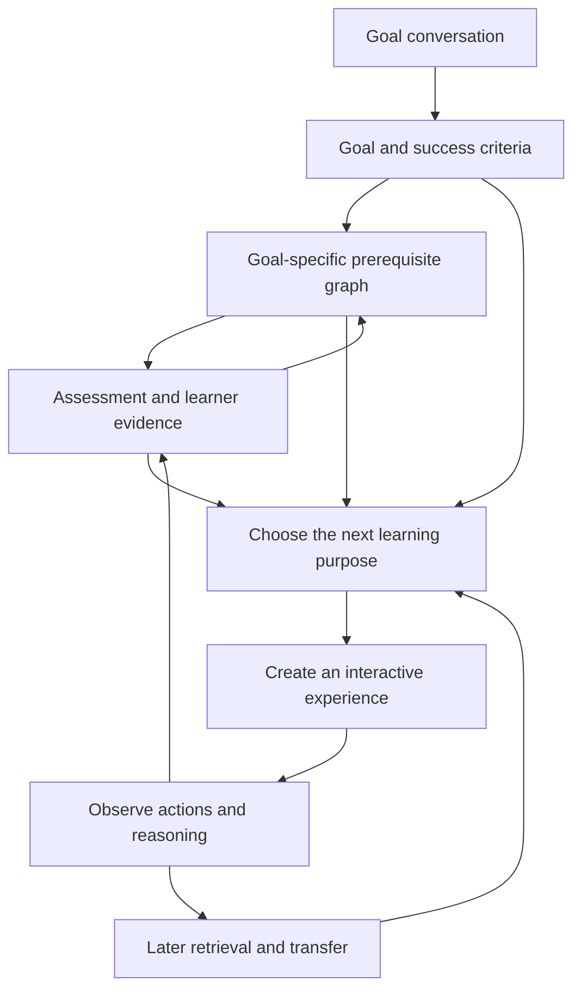

# AI Learning System

An adaptive learning system that understands what a person wants to become capable of, discovers their current understanding, and creates interactive learning experiences to help them reach that goal.

**Core idea:** use LLM intelligence throughout the learning journey—goal discovery, diagnosis, prerequisite mapping, experience creation, feedback, and adaptation. Generate the learning interface when the learning need calls for it.

This README captures the product direction and conceptual design. It describes intended behavior; it is not a claim that these capabilities are already implemented.

The [file-based data model proposal](docs/file-data-model.md) defines the proposed goal-folder layout and component responsibilities using Unix design principles. A shared capture library records raw interactions; separate components assess them and update the learning state. Detailed functionality and schemas will be designed one at a time.

The [three-layer architecture](docs/architecture.md) describes Application, Data, and Intelligence, their file permissions, and an example call stack from lesson submission through assessment and the next activity.

## Product vision

The experience begins as a conversation and gradually becomes a personal learning environment. The system maintains an evolving understanding of the learner and uses it to choose what should happen next.

The learner should be able to answer:

- What am I working toward?
- Why am I doing this activity?
- How does this connect to what I want to learn?
- What have I demonstrated, and where do I still need help?

The system continually answers:

- What capability is this person trying to develop?
- What does the available evidence suggest about their understanding?
- What experience would help them next?

## The learning journey

### 1. Discover the goal through conversation

The learner can begin with a concrete ambition, a vague interest, or a difficulty they cannot yet describe precisely.

The system explores their motivation, intended use, background, constraints, and desired depth. It extracts a proposed goal from that conversation and lets the learner correct it.

For example:

> “Transformers feel like magic. I want to build a small one myself.”

Could become:

> “Implement a small decoder-only Transformer in PyTorch, explain how its main components work together, and diagnose basic implementation mistakes.”

The resulting goal model includes the desired capability, relevant situations, required depth, and evidence that would demonstrate success. Preserve the learner's original intent alongside the clarified goal.

### 2. Discover the learner's current understanding

Use relevant predictions, explanations, small challenges, and demonstrations to find a useful starting point.

Assessment should investigate both knowledge and reasoning. Distinguish unfamiliarity, misconceptions, calculation slips, notation difficulties, and dependence on support. Ask a follow-up when the evidence is ambiguous.

Stop the initial assessment when there is enough evidence to begin useful learning. Continue assessing through subsequent activities.

### 3. Build a goal-specific prerequisite graph

Identify the concepts and skills needed for the goal, their relationships, and the depth required for each.

Depth can include recognizing, explaining, calculating, applying, implementing, debugging, performing, or transferring a capability. These dimensions can develop separately: a learner may explain something accurately while struggling to use it.

Goal discovery, assessment, and graph construction inform one another. The initial graph is provisional and can become more precise during learning.

Present an understandable route first, with the option to inspect the graph and the reasons behind its connections.

### 4. Create interactive learning experiences

Choose a learning purpose, then create the interaction that serves it.

An experience might ask the learner to predict an outcome, manipulate a simulation, assemble a system, debug a fault, explain a decision, or perform a skill. Explanations and worked examples provide support when needed, followed by opportunities to reason with less assistance.

Every experience should specify:

- The capability it aims to develop or assess.
- What meaningful action the learner must take.
- What feedback and support are available.
- What evidence the interaction can provide.
- How it connects to the learner's goal.

### 5. Adapt continuously

Observe actions and reasoning, update the learner model, and choose the next learning purpose.

The system can repair a prerequisite, change the representation, remove support, increase difficulty, combine concepts, introduce transfer, or schedule later retrieval.

When a detour is needed, preserve the learner's unfinished work and return them to it afterward.

### 6. Demonstrate the intended capability

Evaluate progress against the agreed goal through meaningful work: a solution, explanation, project, performance, decision, or unfamiliar application.

Show what the learner demonstrated independently, what still required support, and what needs a later revisit. Reaching a goal can lead to consolidation, a deeper goal, or a new direction.

## How the ideas fit together

Six conceptual parts support this loop:

| Part | Responsibility |
| --- | --- |
| Goal model | Maintain the learner's intent, scope, required depth, constraints, and success criteria. |
| Knowledge model | Represent concepts, skills, and meaningful relationships between them. |
| Learner model | Maintain evidence, misconceptions, assistance history, retention signals, and uncertainty. |
| Learning director | Decide the next learning purpose using the goal, graph, evidence, and unfinished work. |
| Experience creator | Generate or adapt an interactive experience suited to that purpose. |
| Evidence interpreter | Interpret the learner's actions and reasoning, and update the learner model with justified conclusions. |

These are conceptual responsibilities. The implementation architecture remains open.

## Is the graph static?

The graph is open to change. Separate three layers so each can evolve for the right reasons.

| Layer | Represents | Changes when |
| --- | --- | --- |
| Knowledge graph | Concepts, skills, and relationships within a subject. | A missing dependency, alternative route, or better-supported relationship is identified. |
| Goal-specific graph | Relevant capabilities and their required depth for this goal. | The goal changes, additional requirements emerge, or a better route is justified. |
| Learner understanding | Evidence about this person's capabilities within the graph. | They act, explain, use support, retrieve knowledge later, or apply it in a new context. |

A single wrong answer primarily changes the system's uncertainty about the learner. It may change their route without changing the underlying knowledge relationships. Repeated evidence might reveal a missing prerequisite and justify revising the graph itself.

Relationships also need distinct meanings:

- **Prerequisite:** needed to learn or perform another capability at the specified depth.
- **Component skill:** exercised as part of a broader capability.
- **Helpful connection:** provides a useful analogy, context, or alternative approach.
- **Interpretive relationship:** connects perspectives or competing explanations where appropriate to the subject.

Graph revisions should preserve their rationale and distinguish established relationships from provisional hypotheses. Changes to the goal should preserve relevant prior learning evidence.

## What LLM intelligence contributes

LLMs can interpret ambiguous intent, ask diagnostic questions, reason about dependencies, generate alternative representations, create interactive tasks, interpret explanations, and propose the next learning action.

The system should maintain explicit goals and learning evidence across those interactions. A fluent explanation or an attractive generated interface does not establish that learning occurred.

Generated experiences need to be coherent with their teaching purpose, provide meaningful feedback, and support the conclusions drawn from learner behavior. Generated content and inferred relationships need checks appropriate to the subject.

## Interactive experience types

| Experience | Learning purpose |
| --- | --- |
| Predict, then explore | Reveal the learner's mental model before showing an outcome. |
| Manipulable simulation | Explore relationships by changing conditions and observing consequences. |
| Construction task | Assemble parts into a functioning whole. |
| Worked example with fading support | Build understanding, then progressively remove guidance. |
| Debugging challenge | Locate and explain a failure, then repair it. |
| Explanation dialogue | Investigate reasoning and resolve ambiguity. |
| Role-play | Practice decisions and communication under changing conditions. |
| Retrieval challenge | Reconstruct earlier knowledge after a meaningful interval. |
| Transfer task | Apply a capability in an unfamiliar context. |
| Artifact or performance critique | Evaluate work against relevant criteria and guide revision. |

A familiar workspace should provide continuity while the learning surface adapts. Preserve the goal, current task, saved work, and return point across changes.

## Adaptation, difficulty, and spaced repetition

Adaptation should respond to the kind of evidence available.

| Observation | Possible next action |
| --- | --- |
| Correct answer with weak or unclear reasoning | Ask a targeted follow-up. |
| Success after substantial guidance | Offer a later attempt with less support. |
| Repeated difficulty with the same dependency | Provide a focused prerequisite detour. |
| Independent success across varied tasks | Increase complexity or introduce transfer. |
| Difficulty recalling an earlier capability | Schedule targeted retrieval and reassess support needs. |
| Successful use of a component skill inside a larger task | Credit that practice where the task actually exercised the skill. |

Spaced repetition targets capabilities that need reinforcement. A revisit can use a new task, context, or representation. Review scheduling should consider recency, performance, assistance, goal relevance, and the evidence of retention.

Difficulty has several dimensions: complexity, ambiguity, novelty, number of interacting concepts, time constraints where relevant, and the amount of support available.

## Ten learner journeys

These hypothetical journeys serve as design tests across subjects and types of capability.

### 1. Experienced programmer learning Transformers

**Goal:** implement a small Transformer and explain its components.

Assessment samples tensor reasoning, probability, and neural-network fundamentals. Strong programming evidence allows a quick move into an attention construction task. A masking misconception triggers an interactive experiment, then a return to the saved implementation.

The graph emphasizes implementation and debugging. A later research goal expands the required depth and dependencies.

### 2. School student struggling with algebra

**Goal:** become confident solving equations encountered in class.

Conversation turns a vague sense of difficulty into a concrete goal. A visual balance puzzle reveals that equality is understood but negative numbers are causing confusion. Targeted practice repairs that dependency before equations become more complex.

The route adapts to the earlier gap. Later retrieval and independent reasoning provide stronger evidence than completion alone.

### 3. Traveler learning Japanese

**Goal:** manage restaurants, trains, and simple conversations during a trip.

Assessment samples listening and speaking in relevant situations. Generated role-plays begin with prompts, then introduce unexpected replies. Strong written answers alongside weak listening lead to more listening practice.

The graph tracks listening, speaking, and reading separately. Travel needs determine vocabulary and depth; extensive writing may remain outside the goal.

### 4. Biology student learning genetics

**Goal:** reason through inheritance problems independently.

A prediction and explanation task reveals whether the learner understands the mechanism behind remembered terminology. An interactive inheritance experiment supports exploration, followed by problems with incomplete information.

Weak probability reasoning adds a targeted prerequisite branch. Later review tests predictions and explanations as well as terminology.

### 5. Adult exploring history

**Goal:** explain why the Roman Republic collapsed using evidence.

The system combines timelines, maps, and contrasting sources. The learner builds a causal explanation and responds to evidence that complicates it.

The graph includes context and competing interpretations alongside prerequisite relationships. Interest in economic causes expands that branch. Assessment considers chronology, source use, and argument quality, allowing defensible differences in interpretation.

### 6. Classical pianist learning jazz improvisation

**Goal:** improvise over a twelve-bar blues.

Conversation and playing samples, when available, establish theory knowledge, rhythm, and ear skills. Experiences include call-and-response, constrained improvisation, and accompaniment with decreasing support.

The graph distinguishes reading, hearing, and performing. Claims about performance require playing evidence; theoretical exercises contribute only to capabilities they demonstrate.

### 7. Manager learning negotiation

**Goal:** handle difficult scope discussions with clients.

Generated role-plays react to the learner's questions and proposals. Feedback identifies missed concerns or unexplored trade-offs. Subsequent scenarios change incentives and increase ambiguity.

Listening, framing, trade-offs, and emotional regulation influence the route with flexible sequencing. Assessment uses explicit criteria, reasoning, and consequences.

### 8. Home baker learning bread science

**Goal:** understand and fix inconsistent sourdough results.

The system gathers observations about actual baking conditions. Interactive experiments explore hydration, temperature, and fermentation. The learner plans a controlled change for their next bake and returns with observations.

The route changes with the likely cause. Understanding percentages and controlling fermentation need different evidence; confidence reflects what the system can observe.

### 9. Marketer learning statistics

**Goal:** make better decisions from A/B tests.

Assessment samples percentages, uncertainty, and experimental design. A simulation shows how repeated samples produce different apparent winners. The learner decides whether to act, gather evidence, or question the experiment.

The graph emphasizes interpretation and decisions. A goal of designing experiments adds further requirements. New business contexts test transfer.

### 10. Developer learning visual design

**Goal:** make app screens clearer and more polished.

The learner critiques examples, edits generated screens, and explains choices involving hierarchy, spacing, typography, and contrast.

The route adapts to demonstrated weaknesses and the app's needs. Assessment combines task clarity, accessibility criteria, reasoning, and critique. Context-dependent choices allow multiple successful solutions.

## Product principles

- Begin with the learner's intended capability.
- Make goal setting conversational and revisable.
- Use assessment to find a useful starting point, then continue learning about the learner.
- Choose the learning purpose before generating the interface.
- Require meaningful learner participation.
- Distinguish independent, hinted, and assisted evidence.
- Keep conclusions proportional to the available evidence and express uncertainty.
- Connect local activities to the larger goal.
- Preserve unfinished work across targeted detours.
- Integrate retrieval, support reduction, and transfer into the journey.
- Adapt assessment to the subject and the nature of the skill.
- Let learners inspect and correct assumptions about their goals and background.

## Related projects and inspiration

These projects inform different parts of the concept. The comparisons below reflect published documentation; they do not establish equivalent capabilities or learning outcomes.

| Project | Relevant direction |
| --- | --- |
| [OpenMAIC](https://github.com/THU-MAIC/OpenMAIC) | Generated interactive lessons, simulations, projects, and AI-guided classroom experiences. |
| [MAIC-UI](https://github.com/THU-MAIC/MAIC-UI) | Generating interactive teaching interfaces from learning content and topics. |
| [Math Academy](https://mathacademy.com/how-our-ai-works) | Diagnostic assessment, prerequisite graphs, student modeling, adaptive tasks, and spaced repetition. |
| [LearningMAP](https://github.com/ai-for-edu/LearningMAP) | Knowledge graph, adaptive quiz, diagnosis, targeted lessons, and cross-session memory. |
| [Brilliant and Koji](https://brilliant.org/help/features/how-does-koji-work/) | Visual problem solving with a tutor that can observe and manipulate the learning environment. |
| [Codecademy AI Builder](https://help.codecademy.com/hc/en-us/articles/44437136852123-AI-Builder-FAQ) | Conversational project creation followed by a project-specific learning path and exercises. |
| [Google Learn Your Way](https://research.google/blog/learn-your-way-reimagining-textbooks-with-generative-ai/) | Personalized representations of source material with embedded questions and multiple formats. |

The proposed system connects goal discovery, goal-specific prerequisite depth, generated interactive experiences, and ongoing adaptation for understanding and retention.

## How to develop the concept next

Start with one complete journey for a specific goal. Define convincing evidence of success, map the required capabilities, and walk several different learners through it.

At each decision point, record:

1. What the system observed.
2. What it inferred and how certain that inference is.
3. Which learning purpose it selected and why.
4. Which experience it created.
5. What evidence would justify the next decision.

Use the ten learner journeys to test whether the underlying model accommodates different subjects, goals, evidence types, and learning routes.

Open design questions include how to validate graph revisions and generated experiences, how to establish credible evidence in subjective or physical domains, and how much control learners should have over sequencing and review.

The next milestone is a coherent, reviewable learning journey with explicit adaptive decisions. That provides the foundation for subsequent interface and implementation choices.
